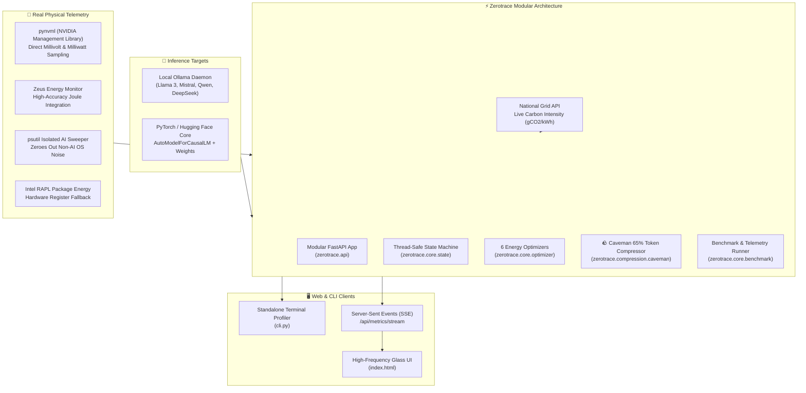

# ⚡ Zerotrace AI — Real-Time Hardware Telemetry & Green AI Profiler

[](https://fastapi.tiangolo.com/)
[](https://ollama.ai/)
[](https://developer.nvidia.com/)
[](https://ml.energy/zeus/)
[](https://github.com/Madhukumar511/ZEROTRACE-AI)
[](https://github.com/Madhukumar511/ZEROTRACE-AI)
[](LICENSE)

> **Zero synthetic approximations. Real hardware telemetry. Real energy physics.**
> **Cutting tokens by ~65% to slash electricity consumption and eliminate carbon footprint.**

Zerotrace AI is an open-source inference profiler and green energy optimization engine for Large Language Models (LLMs). It captures high-frequency hardware metrics during active inference—measuring true **Joules drawn per token**, **GPU wattage**, and **carbon emissions ($gCO_2$)**—while offering live model optimization techniques, including the **Caveman token compressor**, to drastically slash computational power demand.

---

## 🏛️ System Architecture



---

## 🔬 Core Innovations & Engineering Highlights

### 1. Zero Synthetic Approximations
Most carbon calculators multiply token counts by an arbitrary flat constant. Zerotrace AI runs high-frequency concurrent threads sampling actual physical sensors:
- **NVIDIA NVML:** Direct register queries for device milliwatts (`nvmlDeviceGetPowerUsage`).
- **Zeus Monitor:** Sub-millisecond GPU energy integration windows.
- **Isolated AI CPU Sweeper:** Scans all system process trees for Ollama/Llama PIDs and isolates CPU usage strictly consumed by the AI model.
- **Intel RAPL & TDP Mapping:** Directly reads hardware energy microjoules or architectural TDP registers.

### 2. 🪨 Native Caveman ~65% Token Compression
LLM energy consumption is directly bounded by token length during attention prefill ($O(N^2)$ memory bandwidth) and autoregressive token generation:
- **Aggressive Fluff Elimination:** Prunes conversational pleasantries ("Sure, I'd be happy to...", "In conclusion..."), greetings, hedges, and redundant filler words.
- **Article Stripping:** Drops standalone articles (`a`, `an`, `the`) and compresses wordy verb phrases into dense smart-caveman syntax (`[thing] [action] [reason]`).
- **100% Code & Symbol Integrity:** Preserves fenced code blocks (```...```), inline code, mathematical equations, URLs, file paths, and exact error strings verbatim.
- **Native Ollama Baking:** Dynamically injects Caveman system directives directly into local Ollama Modelfiles, constraining generation length by ~65% and saving up to **60–75% of GPU inference electricity**.

### 3. The 6 Live Energy Optimization Techniques
1. **🪨 Caveman Compression (`apply_caveman_compression_optimization`):** Slashes prompt & generation tokens by ~65%, directly eliminating GPU compute time and carbon footprint.
2. **Dynamic Token Limiting (`apply_token_limit`):** Clamps maximum output generation to suppress runaway repetitive generations.
3. **Context Window Trimming (`apply_context_reduction`):** Scales `num_ctx` and active attention matrix memory, drastically reducing KV-cache energy.
4. **Hardware-Aware Routing (`apply_gpu_routing`):** Dynamically toggles layer offloading between GPU VRAM and CPU threads for optimal energy efficiency.
5. **Quantization Spectrum Profiling (`get_quantization_variants`):** Compares bit-width trade-offs from 2-bit (`q2_K`) up to 8-bit (`q8_0`) with energy scale factors.
6. **Hardware Power Capping (`apply_gpu_power_cap`):** Programmatically sets hardware power management limits via NVML to cap maximum allowable GPU wattage.

### 4. Live Carbon Telemetry
Continuously syncs with the Carbon Intensity API to translate energy ($kWh$) into exact grams of $CO_2$ emitted:
$$\text{Emissions } (gCO_2) = \left( \frac{\text{Energy (Joules)}}{3,600,000} \right) \times \text{Carbon Intensity } (gCO_2 / kWh)$$

---

## 📂 Project Structure

```text
ZEROTRACE-AI/
├── zerotrace/                         # Modular package architecture
│   ├── config.py                     # Global configuration & environment settings
│   ├── core/
│   │   ├── state.py                  # Thread-safe application state machine
│   │   ├── benchmark.py              # Telemetry runner & benchmark suite
│   │   ├── optimizer.py              # 6 Live energy optimization techniques
│   │   └── emissions.py              # Real-time carbon intensity tracker
│   ├── telemetry/
│   │   ├── hardware.py               # NVML GPU stats, CPU TDP & RAPL energy
│   │   ├── process.py                # psutil isolated AI process sweeper
│   │   ├── zeus_monitor.py           # Zeus ML monitor interface
│   │   └── aggregator.py             # System power aggregation
│   ├── compression/
│   │   ├── caveman.py                # Caveman ~65% token compression engine
│   │   ├── tokenizer.py              # Subword token counter & green AI metrics
│   │   └── prompt_optimizer.py       # High-level prompt compression coordinator
│   ├── models/
│   │   ├── ollama.py                 # Ollama daemon client & model manager
│   │   └── pytorch_loader.py         # Local PyTorch & HuggingFace model loader
│   └── api/
│       ├── app.py                    # FastAPI app factory & middleware
│       ├── routes_telemetry.py       # Live telemetry & SSE stream routes
│       ├── routes_ollama.py          # Ollama model & optimization routes
│       ├── routes_compression.py     # Caveman compression & green metrics routes
│       └── routes_models.py          # Session, emissions & PyTorch model routes
├── server.py                         # Backward-compatible entrypoint & ASGI server
├── cli.py                            # Standalone terminal profiler & token compressor
├── index.html                        # Real-time glass dashboard with Caveman UI
├── requirements.txt                  # Python dependencies
├── .env.example                      # Environment variables template
└── tests/                            # Automated test suite (31/31 Passing)
    ├── test_server.py                # API and endpoint verification
    ├── test_caveman.py               # Caveman heuristics & token reduction tests
    ├── test_optimizer.py             # Energy optimization technique tests
    └── test_telemetry.py             # Hardware power & sensor tests
```

---

## 🚀 Quickstart Guide

### 1. Installation
```bash
git clone https://github.com/Madhukumar511/ZEROTRACE-AI.git
cd ZEROTRACE-AI

python3 -m venv venv
source venv/bin/activate
pip install -r requirements.txt
```

*(Optional: Install `torch`, `transformers`, `pynvml`, and `zeus-ml` for direct PyTorch and hardware GPU access).*

### 2. Run Automated Tests
```bash
python3 -m pytest tests/ -v
```
*(31/31 tests passing across server, telemetry, optimizer, and Caveman compression suites).*

### 3. Start the Server
```bash
# Ensure Ollama is running if benchmarking local models:
# ollama serve

python server.py
```
Open **`http://localhost:8000`** in your browser to inspect the real-time hardware dashboard and test live Caveman token compression.

### 4. Standalone CLI Profiler & Compressor
```bash
# Stream real-time hardware watts and carbon emissions in your terminal:
python cli.py live

# Compress any prompt with Caveman and measure projected token & electricity savings:
python cli.py compress "Hello assistant! Could you please give a detailed explanation with at least 250 words on how transformer neural networks work? Thank you so much!"

# Inspect system hardware sensors:
python cli.py info
```

---

## 📡 API Reference

| Endpoint | Method | Description |
| :--- | :---: | :--- |
| `/` | `GET` | Serves the interactive telemetry dashboard |
| `/health` | `GET` | Subsystem status, Ollama detection, and live power readings |
| `/api/telemetry/live` | `GET` | High-frequency CPU, RAM, and GPU power snapshot |
| `/api/metrics/stream` | `GET` | Server-Sent Events (SSE) live telemetry data stream |
| `/api/ollama/models` | `GET` | Lists models available in local Ollama daemon |
| `/api/ollama/set-active` | `POST` | Sets active target model for benchmarking |
| `/api/benchmark` | `POST` | Executes real hardware benchmark and records baseline power |
| `/api/ollama/apply-optimization` | `POST` | Applies optimizations (`caveman`, `token_limit`, `context_reduction`, `gpu_lean`, `cpu_lean`, `power_cap`) |
| `/api/compress` | `POST` | Compresses prompt with Caveman & returns token/Joules/$CO_2$ savings |
| `/api/caveman/stats` | `GET` | Cumulative session token and electricity savings |
| `/api/session` | `GET` | Returns 60-second rolling power averages and session state |
| `/emissions` | `GET` | Historical emissions and energy records |

---

## 📄 License
Distributed under the MIT License. See `LICENSE` for more information.
