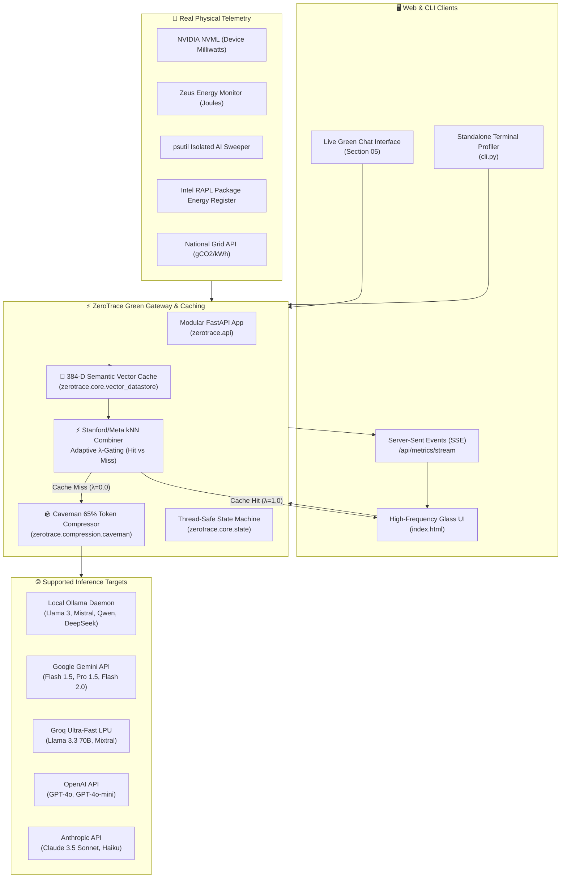

# ⚡ Zerotrace AI — Real-Time Hardware Telemetry & Green AI Inference Gateway

[](https://fastapi.tiangolo.com/)
[](https://ollama.ai/)
[](https://github.com/Madhukumar511/ZEROTRACE-AI)
[-00c853?style=for-the-badge)](https://github.com/Madhukumar511/ZEROTRACE-AI)
[](https://github.com/Madhukumar511/ZEROTRACE-AI)
[](https://github.com/Madhukumar511/ZEROTRACE-AI)
[](LICENSE)

> **Zero synthetic approximations. Real hardware telemetry. Real energy physics.**  
> **Cutting tokens by ~65% and delivering 0-Watt instant responses with 384-D Semantic Vector Caching.**

**Zerotrace AI** is an open-source Green AI inference gateway, hardware profiler, and semantic caching engine for Large Language Models (LLMs). It intercepts requests before they hit heavy GPU clusters, applying:
1. **384-D Semantic Vector Caching** — Instantly answers repetitive/near-duplicate queries in **<5ms with 0 GPU Joules, 0 API tokens, and 0 Watts**.
2. **🪨 Caveman Token Compression** — Slashes conversational filler and pleasantries by **~65%** on novel queries without losing code or technical meaning.
3. **Multi-Model Inference Gateway** — Connects seamlessly to **Local Models** (Ollama, PyTorch) and **Cloud Models** (Google Gemini, OpenAI, Groq, Anthropic Claude).
4. **Real-Time Physical Telemetry** — Captures true hardware **Joules drawn per token**, **GPU wattage (NVML)**, **isolated CPU power (RAPL)**, and **carbon emissions ($gCO_2$)**.

---

## 🏛️ System Architecture



---

## 💻 1-Click Quickstart for Laptops

ZeroTrace AI is designed to run out of the box on any developer laptop with **zero manual setup** across Windows, macOS, and Linux.

### 🌐 Universal Command (Any OS, Any Directory)

Run from any terminal or folder:
```bash
# Start interactive Green AI Chat:
zerotrace
# or
python -m zerotrace

# Start the Green Web Dashboard & API server:
zerotrace ui

# Stream real-time hardware watts & carbon:
zerotrace live

# Compress prompt tokens with Caveman (~65% reduction):
zerotrace compress "Explain how transformers work..."

# Audit hardware sensors, TDP, and Ollama daemon:
zerotrace info
```

To enable the `zerotrace` binary globally across any path:
```bash
pip install -e /path/to/ZEROTRACE-AI
```

> **🔍 Instant Auto-Discovery Engine:**  
> When launched, ZeroTrace automatically scans your machine and connects immediately:
> - **Offline Models**: Detects local Ollama models (`llama3:latest`, `deepseek`, `mistral`) and offline weight files (`.gguf`, `.safetensors`, `.bin` in `./models`).
> - **AI Developer Agents**: Detects Google Antigravity CLI (`agy` via MCP), Cursor, and Claude Code (via `/v1` proxy).
> - **Hardware Sensors**: Detects Intel RAPL microsecond energy registers and NVIDIA NVML device milliwatts.

---

### 🚀 1-Click Launchers (Web Dashboard + Backend)

#### Linux & macOS (1-Click Run)
```bash
./run.sh
```
*What `./run.sh` does automatically:*
- Detects Python 3.9+ and creates an isolated virtual environment (`.venv`).
- Installs all dependencies from `requirements.txt`.
- Auto-discovers local models and hardware sensors.
- Launches the server and automatically opens **`http://localhost:8000`** in your browser!

#### Windows (1-Click Run)
Double-click **`run.bat`** or run in CMD / PowerShell:
```cmd
run.bat
```

---

## 💬 Live Green Chat & Inference Gateway

ZeroTrace AI includes a full-featured **Live Green Chat** right on the dashboard (**Section 05**):

### 1. Dual Local & Cloud Model Support
- **Local Models:** Connects to local **Ollama** (`llama3:latest`, `mistral`, `deepseek-r1`, `phi3`, `qwen2.5`) for 100% offline, private inference.
- **Cloud Models:** Connects directly to **Google Gemini** (`gemini-1.5-flash`), **Groq** (`llama-3.3-70b-versatile`), **OpenAI** (`gpt-4o-mini`), and **Anthropic** (`claude-3-5-sonnet`).
- **Zero API Friction:** Enter your API key directly in the web UI (stored securely in browser `localStorage`), or set it in your `.env` file.

### 2. 0-Watt Semantic Vector Cache
- Every question is encoded into a **normalized 384-dimensional semantic embedding**.
- On a **Cache Hit** (similarity $\ge 0.88$): The answer is returned in **<5 milliseconds**.
- **Energy burned: 0 GPU Joules. 0 Watts. 0 billable API tokens.**

### 3. 🪨 Caveman Prompt Compression
- For novel questions that must go to a model, Caveman removes conversational noise, pleasantries, and hedging.
- Achieves **~65% prompt token reduction** while preserving code blocks, equations, URLs, and identifiers 100% verbatim.

---

## 🔬 Real Physical Telemetry (No Synthetic Math)

Most carbon calculators multiply token counts by an arbitrary flat constant. Zerotrace AI runs high-frequency concurrent threads sampling actual physical sensors:

- **NVIDIA NVML:** Direct register queries for device milliwatts (`nvmlDeviceGetPowerUsage`).
- **Zeus Monitor:** Sub-millisecond GPU energy integration windows.
- **Isolated AI CPU Sweeper:** Scans all system process trees for Ollama/Llama PIDs and isolates CPU usage strictly consumed by the AI model.
- **Intel RAPL & TDP Mapping:** Directly reads hardware energy microjoules from `/sys/class/powercap/intel-rapl` or architectural TDP registers.
- **Live Carbon Intensity:** Syncs with the National Grid API to convert Joules to grams of $CO_2$:
  $$\text{Emissions } (gCO_2) = \left( \frac{\text{Energy (Joules)}}{3,600,000} \right) \times \text{Carbon Intensity } (gCO_2 / kWh)$$

---

## 🧪 Automated Test Suite

ZeroTrace AI includes **41 automated tests** covering telemetry, optimizer transitions, Caveman compression, vector datastore persistence, and multi-model chat routing:

```bash
python3 -m pytest tests/ -v
```

Output:
```text
======================== 41 passed, 1 warning in 1.80s =========================
```

---

## 📂 Repository Structure

```text
ZEROTRACE-AI/
├── run.sh                            # 1-Click launcher for Linux & macOS laptops
├── run.bat                           # 1-Click launcher for Windows laptops
├── server.py                         # ASGI FastAPI server entrypoint
├── cli.py                            # Standalone terminal profiler & token compressor
├── index.html                        # Real-time Glass UI & Live Green Chat (Section 05)
├── requirements.txt                  # Python dependencies (fastapi, uvicorn, numpy, etc.)
├── .env.example                      # Template for configuration & cloud API keys
├── zerotrace/                        # Core modular engine package
│   ├── config.py                     # Centralized settings & hardware paths
│   ├── core/
│   │   ├── state.py                  # Thread-safe state & pre-seeded vector cache
│   │   ├── vector_datastore.py       # 384-D normalized vector cache with dot-product search
│   │   ├── knn_combiner.py           # Stanford/Meta kNN gating logic (λ-gate)
│   │   ├── embedder.py               # FastSemanticEmbedder (SentenceTransformers / subword projection)
│   │   ├── benchmark.py              # Telemetry runner & benchmark suite
│   │   ├── optimizer.py              # 6 Live energy optimization techniques
│   │   └── emissions.py              # Real-time grid carbon intensity tracker
│   ├── telemetry/
│   │   ├── hardware.py               # NVML GPU stats, CPU TDP & RAPL energy
│   │   ├── process.py                # psutil isolated AI process sweeper
│   │   ├── zeus_monitor.py           # Zeus ML monitor interface
│   │   └── aggregator.py             # System power aggregation (CPU + GPU + Base)
│   ├── compression/
│   │   ├── caveman.py                # Caveman ~65% token compression engine
│   │   ├── tokenizer.py              # Subword token counter & green AI metrics
│   │   └── prompt_optimizer.py       # High-level prompt compression coordinator
│   ├── models/
│   │   ├── ollama.py                 # Local Ollama client & model manager
│   │   ├── cloud.py                  # CloudLLMClient (Gemini, OpenAI, Groq, Claude)
│   │   └── pytorch_loader.py         # Local PyTorch & HuggingFace model loader
│   └── api/
│       ├── app.py                    # FastAPI app factory & CORS configuration
│       ├── routes_chat.py            # Unified Green Chat & Caching Gateway API
│       ├── routes_telemetry.py       # Live telemetry & SSE stream routes
│       ├── routes_ollama.py          # Ollama model & optimization routes
│       ├── routes_compression.py     # Caveman compression & green metrics routes
│       └── routes_models.py          # Session, emissions & PyTorch model routes
└── tests/                            # Complete automated test suite (41 tests)
    ├── test_chat.py                  # Multi-provider chat & vector cache hit tests
    ├── test_vector_cache.py          # Vector datastore, kNN gate, & persistence tests
    ├── test_caveman.py               # Caveman heuristics & token reduction tests
    ├── test_optimizer.py             # Energy optimization profile tests
    ├── test_server.py                # API and endpoint verification
    └── test_telemetry.py             # Hardware power & sensor tests
```

---

## 📡 API Reference

| Endpoint | Method | Description |
| :--- | :---: | :--- |
| `/` | `GET` | Serves the interactive telemetry dashboard & Live Green Chat |
| `/api/chat` | `POST` | **Unified Green Chat Gateway** (Vector cache check $\to$ Caveman $\to$ Model dispatch) |
| `/v1/chat/completions` | `POST` | **OpenAI-Compatible Reverse Proxy** (For Cursor, LangChain, CLI agents with 0W Cache & Caveman) |
| `/api/chat/providers` | `GET` | Lists available local models (Ollama) and cloud providers |
| `/api/cache/stats` | `GET` | Returns vector cache size, cache hits, and cumulative energy saved |
| `/api/compress` | `POST` | Compresses any prompt with Caveman & returns token/Joules/$CO_2$ savings |
| `/api/caveman/stats` | `GET` | Cumulative session token and electricity savings |
| `/health` | `GET` | Subsystem status, Ollama detection, and live power readings |
| `/api/telemetry/live` | `GET` | High-frequency CPU, RAM, and GPU power snapshot |
| `/api/metrics/stream` | `GET` | Server-Sent Events (SSE) live hardware telemetry data stream |
| `/api/ollama/models` | `GET` | Lists models available in local Ollama daemon |
| `/api/benchmark` | `POST` | Executes real hardware benchmark and records baseline power |
| `/api/ollama/apply-optimization` | `POST` | Applies optimizations (`caveman`, `token_limit`, `context_reduction`, `gpu_lean`, `cpu_lean`, `power_cap`) |
| `/api/session` | `GET` | Returns 60-second rolling power averages and session state |
| `/emissions` | `GET` | Historical emissions and energy records |

---

## 💬 Chat Naturally with ZeroTrace AI

You don't need complicated subcommands or manual profilers. **Just run one command to start chatting naturally with the AI**, and ZeroTrace operates transparently in the background:

### Option 1: Terminal Green Chat (Instant, 1 Command)
```bash
python cli.py
```
> **What happens automatically while you chat:**
> - ⚡ **384-D Semantic Vector Cache**: Instant **0-Watt response in <5ms** if a similar question was asked before.
> - 🪨 **Caveman Compression**: Automatically trims fluff, pleasantries, and hedging by **~65%** on novel queries while strictly preserving code.
> - 🔌 **Real Hardware Telemetry**: Calculates exact Watts consumed, Joules saved, and $gCO_2$ prevented per message.
> - 🌐 **Multi-Model Support**: Automatically detects Local Ollama or Cloud LLMs (Google Gemini, Groq, OpenAI, Anthropic Claude).
>
> *Ask one-shot questions directly from your terminal:*
> ```bash
> python cli.py "How to reverse a string in python"
> ```

---

### Option 2: Web Dashboard & Live Gateway
```bash
./run.sh      # Linux / macOS
run.bat       # Windows
```
> Launches the interactive web dashboard on `http://localhost:8000`. Head straight to **Section 05 — Green Inference Gateway** to chat with full real-time visual power gauges and impact scoreboards.

---

### 🔧 Optional Advanced Developer Tools
For power users wanting raw telemetry streams:
```bash
python cli.py live              # Continuous live hardware watts & carbon table
python cli.py compress "text"   # Dry-run Caveman prompt compression inspector
python cli.py info              # Inspect hardware sensors, TDP, and Ollama status
```

---

## 📄 License
Distributed under the MIT License. See `LICENSE` for more information.
